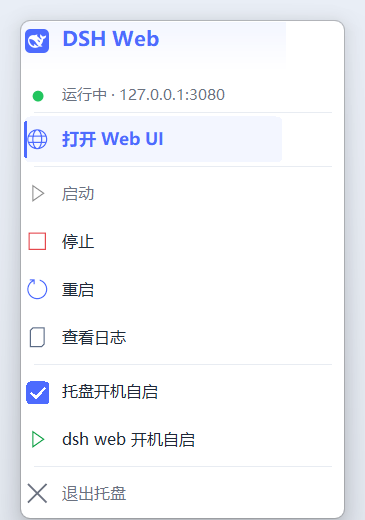

# dsh-web-tray

在 Windows 任务栏/通知区域管理 WSL 里的 **dsh Web UI**：启动、停止、重启、查看日志、开机自启，不用一直占着一个终端窗口。



## 功能

- **鲸鱼图标**：蓝色 = 运行中，灰色 = 已停止；多尺寸 ICO，按 Windows DPI 自动选择
- **现代菜单**：自绘圆角卡片、品牌蓝高亮、图标与文字视觉中心对齐、跟随浅色/深色主题
- **后台托管**：WSL 侧用 `setsid` 启动，关闭终端不影响 dsh web
- **两个独立自启开关**：
  - 托盘开机自启
  - dsh web 开机自启（独立 Startup 快捷方式，不依赖托盘）
- **桌面 + 开始菜单快捷方式**
- 单实例托盘；日志和 PID 在 `~/.local/state/dsh-web/`
- 托盘菜单支持：打开 Web UI、启动、停止、重启、查看日志、退出托盘

## 目录

```
dsh-web-tray/
├── bin/
│   └── dsh-web                 # WSL 侧后台管理器
├── windows/
│   ├── dsh-web-tray.ps1        # 托盘主程序（PowerShell + WinForms）
│   ├── dsh-web-tray.vbs        # 无窗口启动托盘
│   ├── dsh-web-autostart.vbs   # 登录时启动 dsh web
│   ├── install.ps1             # 创建桌面/开始菜单/自启快捷方式
│   ├── README.txt              # 面向使用者的说明
│   └── icons/
│       ├── dsh-web-running.ico
│       └── dsh-web-stopped.ico
├── tools/
│   └── build-icons.js          # 从 dsh favicon 生成多尺寸 ICO
├── docs/
│   └── menu-preview.png
├── install.sh
└── README.md
```

## 环境要求

- Windows 10/11，Windows PowerShell 5.1
- WSL2 Ubuntu（默认发行版名 `Ubuntu`，默认用户 `yanyifan`）
- 已安装 `dsh`，并且 `dsh web` 能正常启动
- 重新生成图标需要 Node.js 和 dsh 自带的 `sharp`（脚本会自动定位）

## 安装

```bash
git clone <your-repo-url> ~/projects/profession/dsh-web-tray
cd ~/projects/profession/dsh-web-tray
./install.sh --restart
```

`install.sh` 会：

1. 安装 `bin/dsh-web` 到 `~/.local/bin/dsh-web`
2. 复制 Windows 文件到 `%LOCALAPPDATA%\DSH`
3. 创建桌面和开始菜单快捷方式 `DSH Web Tray`
4. `--restart` 时重启正在运行的托盘（不会停止 dsh web）

它不会改动你已有的两个开机自启设置。

如果 `%LOCALAPPDATA%` 解析不到，可以手动指定：

```bash
DSH_WIN_APPDIR=/mnt/c/Users/<you>/AppData/Local/DSH ./install.sh --restart
```

## 两个开机自启

菜单里有两个独立开关：

| 菜单项 | 创建的 Startup 快捷方式 | 登录时行为 |
| --- | --- | --- |
| 托盘开机自启 | `DSH Web Tray.lnk` → `dsh-web-tray.vbs` | 启动托盘 |
| dsh web 开机自启 | `DSH Web Server.lnk` → `dsh-web-autostart.vbs` | 运行 `dsh-web start`，启动服务 |

它们互不依赖：

- 只开托盘自启：登录后托盘在，但 dsh web 要手动点“启动”
- 只开 web 自启：登录后 dsh web 自动启动，托盘可以不启动
- 两个都开：登录后托盘和服务都启动

切换开关会立即创建/删除 Startup 快捷方式，但“自动启动服务”只在下一次登录时发生。本次想立即启动，点托盘里的 **启动**。

## 菜单

- **打开 Web UI**：服务未运行时先启动，再打开 `http://127.0.0.1:3080`
- **启动 / 停止 / 重启**
- **查看日志**：用记事本打开最近的 WSL 日志
- **托盘开机自启 / dsh web 开机自启**：两个独立勾选项
- **退出托盘**：只退出托盘，不停止 dsh web

## WSL 命令

```bash
~/.local/bin/dsh-web start
~/.local/bin/dsh-web stop
~/.local/bin/dsh-web restart
~/.local/bin/dsh-web status
~/.local/bin/dsh-web logs
```

- 日志：`~/.local/state/dsh-web/web.log`
- PID：`~/.local/state/dsh-web/web.pid`
- 端口默认 `3080`，可用 `DSH_WEB_PORT` 覆盖

## 图标

图标来自 dsh 自带的前端 favicon：

```
<dsh package>/node_modules/@deepseek-ai/dsh-web-frontend/dist/favicon.svg
```

重新生成：

```bash
node tools/build-icons.js
```

- 自动从 `dsh` 定位 dsh 包和其中的 `sharp`
- 输出到 `%LOCALAPPDATA%\DSH`，可用 `DSH_WIN_APPDIR` 覆盖
- 生成 16/20/24/28/32/40/48/64/128/256 多尺寸 ICO
- 小尺寸用 32-bit BMP 条目，256 用 PNG 条目

## 预览菜单

```bash
powershell.exe -File windows/dsh-web-tray.ps1 -PreviewMenu
```

会在 `%LOCALAPPDATA%\DSH\menu-preview.png` 生成一张纯色背景的菜单预览图，然后退出。

## 配置

默认值写死在两个地方：

- `windows/dsh-web-tray.ps1` 顶部：`$script:Distro`、`$script:WslUser`、`$script:WebUrl`
- `windows/dsh-web-autostart.vbs`：发行版名、用户名、`dsh-web` 路径

如果修改端口，还需要同步：

- `bin/dsh-web` 的 `DSH_WEB_PORT` 默认值
- `windows/dsh-web-tray.ps1` 的 `$script:WebUrl`

## Git 远程

仓库名建议：**`dsh-web-tray`**。

```bash
git remote add origin git@github.com:<you>/dsh-web-tray.git
git push -u origin main
```

或 Gitee：

```bash
git remote add origin git@gitee.com:<you>/dsh-web-tray.git
git push -u origin main
```

## 说明

- 停止/重启 dsh web 会中断当前浏览器页面，刷新即可恢复。
- 托盘默认管理 `127.0.0.1:3080`。
- 如果托盘图标被 Windows 折叠到 `^` 溢出区，拖到任务栏即可常驻。
- 若更改 Windows 显示缩放，退出托盘再启动会按新 DPI 重载。
- dsh 鲸鱼图标来自 dsh 自带 favicon，版权归 DeepSeek；本仓库只做 Windows 图标包装。
